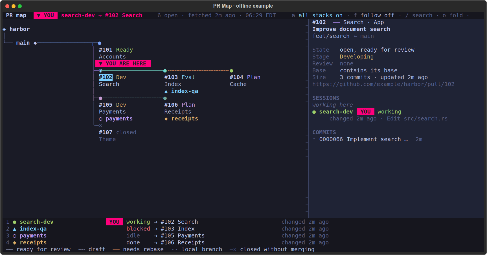
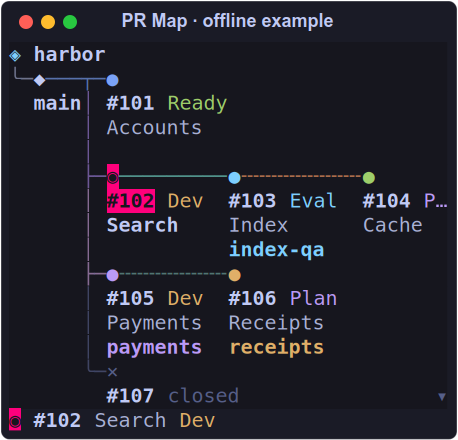
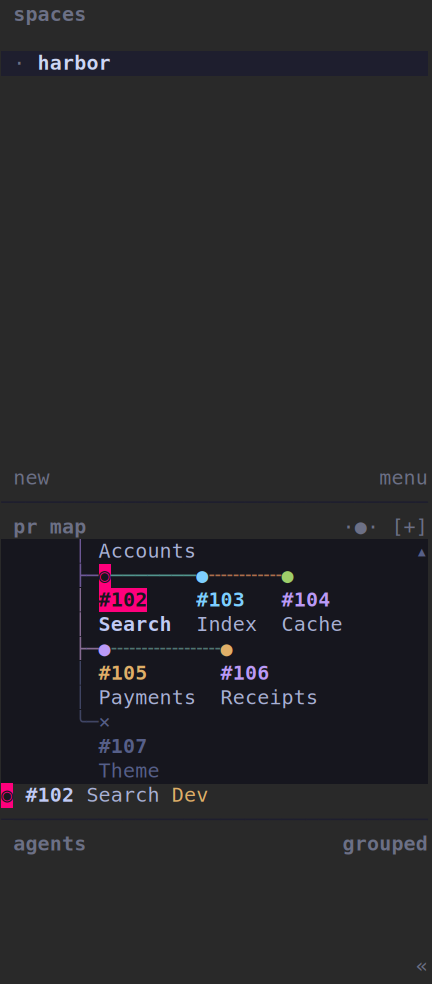

# PR Map

Last updated on 2026-10-19 at commit `c64a442`.

A terminal map of pull-request stacks and the coding agents working on them. See where a session
is working, follow a stack, and open the full map from a small panel between Herdr's Spaces and
Agents sections.



Every screenshot uses the bundled **fictional `example/harbor` project**. The demo runs offline;
it does not inspect your repositories, GitHub account or agent transcripts. When opened inside
an existing Herdr session, it uses fictional pane identities for the demo position.

## Try the demo

Linux is the supported platform for this alpha. The backend is Rust; the full map is a packaged
Python/Textual app. Source installation needs Rust 1.90 or newer, Python 3.11 or newer with venv,
and a C compiler/linker. Git and GitHub CLI are only needed for live data.

```sh
git clone https://github.com/yukiumi13/pr-map.git
cd pr-map
./scripts/install.sh
export PATH="$HOME/.local/bin:$PATH"
pr-map --demo
```

The installer builds `prmap` with Cargo.lock, installs the Python UI in a dedicated venv using
`requirements.lock`, and writes two commands under `~/.local/bin`. Pass another prefix as the
first argument to install elsewhere. It does not change your shell or Herdr configuration.

```sh
pr-map --demo --minimap   # ANSI panel on stdout
pr-map --demo --json      # fictional model as JSON
prmap --version
```



## Connect a real workspace

Authenticate GitHub CLI with an account that can read the target repository. Create
`~/.config/pr-map/config.toml`, or `$XDG_CONFIG_HOME/pr-map/config.toml` when set:

```toml
repo = "example/harbor"
workspace = "/path/to/workspace"
checkout = "/path/to/workspace/harbor"
```

`checkout` supplies Git objects and its registered worktrees; keep its remote refs current through
your usual Git workflow. `workspace` bounds session discovery. Paths may be absolute or relative
to the configuration file. Optional `aliases = ["/old/workspace/path"]` recognizes compatibility
symlinks in old transcript paths.

Use `pr-map --config /path/to/config.toml`, or export `PRMAP_CONFIG` before launching Herdr. Without
a config file, the current Git checkout and its GitHub `origin` are inferred. To combine several
worktrees under one map, use an explicit config so each provider invocation selects the same root.

```sh
pr-map                     # full map; Herdr itself is optional
pr-map --json              # inspect the live model
prmap model --force        # refetch PRs explicitly
```

The map reads PR metadata with `gh`, local Git ancestry/worktrees, Herdr's agent snapshot, and the
recent tool-call records of the associated Claude/Codex sessions. A session is placed by its latest
change record that is not marked failed, then its latest read, then its working directory. Placement is an inference,
and the detail panel exposes its evidence. Commands and transcript content are not uploaded.

Optional PR title tags supply category colours and stages, for example
`[App: Search] [Developing] Improve document search`. Untagged PRs work too, using their branch
names. Drafts, closed PRs and branches without a PR have distinct line styles.

## Put the minimap in Herdr's sidebar



The native sidebar surface currently requires the matching
[Herdr minimap fork](https://github.com/yukiumi13/herdr/tree/pr-minimap). Official Herdr can still
open the full map, but does not contain this sidebar extension.

Build that fork as described in its [setup guide](https://github.com/yukiumi13/herdr/blob/pr-minimap/docs/next/minimap-fork.md).
Merge [examples/herdr.toml](examples/herdr.toml) into your Herdr configuration, usually
`~/.config/herdr/config.toml`:

```toml
[ui.sidebar.panel]
title = "pr map"
command = "pr-map --minimap"
rows = 12
interval_seconds = 5
timeout_seconds = 5
click_command = "pr-map --popup"
click_width = "95%"
click_height = "90%"
zoom_levels = 3
zoom = 1
```

For the offline example, use `pr-map --demo --minimap` and `pr-map --demo --popup` instead.
The wheel changes zoom, dragging pans, and clicking a station opens it in the full map.
The fork uses manual updates and blocks the official binary updater so the extension is retained.

In the full map: arrows or `hjkl` navigate; `Tab`/`Enter` select sessions; `o` folds a stack;
`a` opens all stacks; `f` follows your session; `/` searches; `r` refetches; `q` exits. A session
jump focuses its Herdr pane. The offline demo never focuses or changes a real session.

## How it works

```text
Herdr panel command -> prmap minimap -> model/cache -> ANSI output + immutable frame
Herdr accepts output and retains that frame id
Herdr click -> pr-map --popup -> saved frame model + clicked station -> Textual full map
Periodic UI refresh -> prmap model -> current live model
```

The accepted frame id binds a click to the cells actually displayed. A different view cannot
overwrite its lookup. A failed provider refresh retains the prior output and frame; after a
resize, native clicks omit stale coordinates until matching output arrives. The cache keeps the
last 64 frames per panel producer; an expired frame opens the current map with an explanation.

Caches live below `$XDG_CACHE_HOME/pr-map/` (default `~/.cache/pr-map`), separated by repository,
checkout and Herdr session. Models are reused for four seconds; PR metadata for five minutes.
Failed PR fetches retain the previous PR list. A missing Herdr snapshot gives a PR-only map.

| Source | Responsibility |
|---|---|
| `src/main.rs`, `config.rs` | CLI boundary, configuration, offline/live selection |
| `src/model.rs`, `sources.rs`, `sessions.rs` | PR/Git/Herdr sources and session placement |
| `src/layout.rs`, `minimap.rs`, `style.rs` | layout, Unicode cells, colours and panel rendering |
| `src/frames.rs` | immutable model/hit records for accepted frames |
| `python/pr_map/` | packaged full map, navigation and backend client |
| `examples/` | fictional demo data and configuration examples |
| `tests/` | isolated CLI/frame tests and real Textual UI tests |

## Development and limits

```sh
cargo fmt --all -- --check
cargo clippy --locked --all-targets -- -D warnings
cargo test --locked
cargo build --locked
python3 -m pip install -c requirements.lock .
PRMAP_TEST_BIN="$PWD/target/debug/prmap" python3 -m unittest discover -s tests -v
```

The alpha candidate passed strict Rust formatting/clippy, three backend unit tests and eight
isolated CLI/Textual tests. An isolated native Herdr test also verified a mouse click end to end,
including the accepted frame id and the selected fictional station. Its fork passed 143 sidebar
tests, 10 command-runner tests and 20 configuration/UI architecture checks.

The checks exercise offline operation, configuration outside the checkout, Unicode/narrow
panels, immutable click selection, UI navigation and resize. They use fictional fixtures and
return a failing status for regressions. GitHub CI runs these checks on Linux.

This alpha has not been qualified for macOS, Windows or long-running multi-client workloads.
A rebuild reads up to 4 MB from each active session transcript; very large/NFS workspaces can
reach the panel command timeout. Herdr then keeps the previous view and shows `stale`.

License: Apache-2.0. Herdr is a separate upstream project; this tool and the minimap fork are
independent of the official Herdr release channels.
